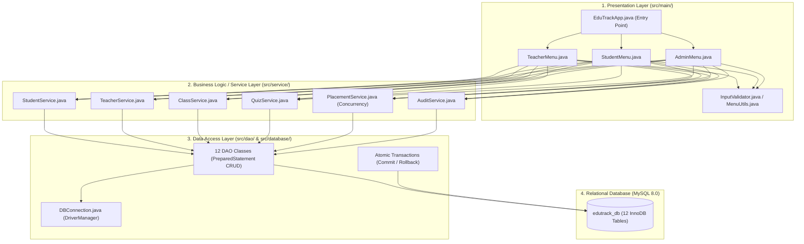

# EduTrack — Architecture, Database Design & Viva Reference

This document provides a comprehensive technical overview of the software architecture, relational database schema, JDBC engineering techniques, and concurrency models implemented in **EduTrack**. It is formatted specifically as an evaluation reference for academic and viva voce assessments.

---

## 1. 3-Layer Enterprise Architecture

EduTrack strictly adheres to the standard **3-Layer Architectural Pattern**, ensuring loose coupling, single responsibility, and maintainability:



### Architectural Layer Responsibilities:
1. **Presentation Layer (`src/main/`)**:
   - Manages console user input/output and navigation menus.
   - Catches all domain and SQL exceptions gracefully, shielding the JVM `main()` from unhandled crashes.
   - **Rule**: Has *zero direct access* to DAOs or JDBC connections; routes all operations exclusively through Services.
2. **Service Layer (`src/service/`)**:
   - Enforces business rules, eligibility criteria, attendance calculations, pass/fail evaluations, and at-risk detection.
   - Coordinates multi-threaded synchronized slot allocation.
   - **Rule**: Contains *no raw SQL queries* and *no JDBC imports*; all database persistence is handled by DAOs.
3. **Data Access Object (DAO) Layer (`src/dao/`)**:
   - Encapsulates low-level JDBC mechanics (`PreparedStatement`, `ResultSet` mapping, `RETURN_GENERATED_KEYS`).
   - Manages connection lifecycle and atomic transactional rollback boundaries.
   - Translates SQL error codes into domain exceptions (`DuplicateRecordException`, `RecordNotFoundException`).

---

## 2. 12-Table Relational Schema (`edutrack_db`)

The database uses the MySQL 8.0 InnoDB engine with full ACID compliance and referential integrity:

```mermaid
erDiagram
    TEACHER ||--o{ CLASS : "instructs"
    STUDENT ||--o{ CLASS_ENROLLMENT : "enrolls"
    CLASS ||--o{ CLASS_ENROLLMENT : "contains"
    CLASS ||--o{ CLASS_PROGRESS_LOG : "logs"
    CLASS ||--o{ CLASS_RESOURCE : "shares"
    CLASS ||--o{ QUIZ : "schedules"
    QUIZ ||--o{ QUIZ_SUBMISSION : "receives"
    STUDENT ||--o{ QUIZ_SUBMISSION : "submits"
    COMPANY ||--o{ PLACEMENT_DRIVE : "sponsors"
    PLACEMENT_DRIVE ||--o{ APPLICATION : "receives"
    STUDENT ||--o{ APPLICATION : "applies"
    AUDIT_LOG {
        int log_id PK
        string entity_name
        int entity_id
        string action_type
        string performed_by
        timestamp action_timestamp
        string details
    }
```

### Table Summary & Key Constraints:

| Table Name | Primary Key | Foreign Keys & Unique Constraints | Check Constraints |
|---|---|---|---|
| `TEACHER` | `teacher_id` | Unique: `email`, `phone` | `status IN ('ACTIVE','INACTIVE','ON_LEAVE')` |
| `STUDENT` | `student_id` | Unique: `roll_number`, `email`, `phone` | `semester BETWEEN 1 AND 8`, `cgpa BETWEEN 0.0 AND 10.0` |
| `CLASS` | `class_id` | FK: `teacher_id` $\to$ `TEACHER`<br>Unique: `class_code` | `credits BETWEEN 1 AND 10`, `max_capacity > 0`, `status IN (...)` |
| `CLASS_ENROLLMENT` | `enrollment_id` | FKs $\to$ `CLASS`, `STUDENT`<br>Unique: `(class_id, student_id)` | `attendance_percentage BETWEEN 0 AND 100`, grade checks |
| `CLASS_PROGRESS_LOG` | `log_id` | FK $\to$ `CLASS` | `hours_spent > 0.0 AND <= 12.0` |
| `CLASS_RESOURCE` | `resource_id` | FK $\to$ `CLASS` | `resource_type IN ('SYLLABUS','NOTES','ASSIGNMENT',...)` |
| `QUIZ` | `quiz_id` | FK $\to$ `CLASS` | `total_marks > 0`, `passing_marks <= total_marks` |
| `QUIZ_SUBMISSION` | `submission_id` | FKs $\to$ `QUIZ`, `STUDENT`<br>Unique: `(quiz_id, student_id)` | `score_obtained >= 0.0` |
| `COMPANY` | `company_id` | Unique: `company_name`, `contact_email` | `status IN ('ACTIVE','INACTIVE','BLACKLISTED')` |
| `PLACEMENT_DRIVE` | `drive_id` | FK $\to$ `COMPANY` | `package_lpa > 0.0`, `min_cgpa_criteria BETWEEN 0 AND 10` |
| `APPLICATION` | `application_id` | FKs $\to$ `PLACEMENT_DRIVE`, `STUDENT`<br>Unique: `(drive_id, student_id)` | `status IN ('APPLIED','SHORTLISTED','OFFERED',...)` |
| `AUDIT_LOG` | `log_id` | Non-intrusive logging | `action_type IN ('INSERT','UPDATE','DELETE','LOGIN','LOGOUT')` |

---

## 3. Core JDBC Viva Concepts

### A. PreparedStatement vs. Statement
* **SQL Injection Prevention**: In standard `Statement`, user inputs are concatenated directly into SQL text, allowing attackers to inject malicious payloads (e.g. `' OR '1'='1`). `PreparedStatement` compiles the SQL structure beforehand and binds values as literal parameters (`?`), rendering code injection impossible.
* **Precompilation & Performance**: MySQL caches the parsed binary execution plan. Repeated executions only transfer parameters, reducing query parsing overhead.
* **Type Safety**: Automatic type conversions for dates (`java.sql.Date`), timestamps (`java.sql.Timestamp`), and floating decimals.

### B. Auto-Generated Keys (`Statement.RETURN_GENERATED_KEYS`)
```java
PreparedStatement ps = conn.prepareStatement(SQL_INSERT, Statement.RETURN_GENERATED_KEYS);
ps.executeUpdate();
try (ResultSet rs = ps.getGeneratedKeys()) {
    if (rs.next()) {
        model.setId(rs.getInt(1)); // Captures InnoDB auto-increment primary key
    }
}
```
* **Why?** Eliminates the need for a secondary query like `SELECT LAST_INSERT_ID()`, avoiding race conditions and extra network round-trips.

### C. Atomic Transactions (Commit & Rollback)
Used in `ClassEnrollmentDAO.enrollStudentWithAudit()` and `ApplicationDAO.applyWithAudit()`:
```java
Connection conn = DBConnection.getConnection();
try {
    conn.setAutoCommit(false); // 1. Start atomic transaction

    // Step A: Primary write
    ps1.executeUpdate();

    // Step B: Secondary audit trail on the SAME physical connection
    auditLogDAO.insert(conn, auditEntry);

    conn.commit(); // 2. Atomic persistence
} catch (SQLException e) {
    if (conn != null) {
        conn.rollback(); // 3. Discards all partial writes if any failure occurs
    }
    throw e;
} finally {
    if (conn != null) {
        conn.setAutoCommit(true); // 4. Reset connection before returning to pool
        conn.close();
    }
}
```

---

## 4. Concurrency Control & Thread Safety

### The Check-Then-Act Problem
In campus placement systems, open positions are scarce. Suppose a placement drive has **2 open slots remaining**, and **5 student threads** submit applications simultaneously:
1. Without synchronization, all 5 threads check database count: `count = 0 < 2`.
2. All 5 threads see that slots are available.
3. All 5 threads execute `INSERT`.
4. Total applications become 5 (**Over-allocation defect**).

### EduTrack Solution: Per-Drive Monitor Synchronization
In [PlacementService.java](file:///d:/Edutrack/src/service/PlacementService.java):
```java
Object lock = driveLocks.computeIfAbsent(driveId, k -> new Object());
synchronized (lock) {
    List<Application> currentApps = applicationDAO.findByDriveId(driveId);
    if (currentApps.size() >= maxVacancies) {
        throw new EligibilityException("Drive capacity exhausted: All slots filled.");
    }
    return applicationDAO.applyWithAudit(app, performedBy);
}
```
* **Why Per-Drive Lock?** Synchronizing on `driveId` monitor objects ensures high throughput: concurrent applications for *Drive #1* and *Drive #2* run simultaneously on different cores without blocking each other, while applicants to the *same drive* are strictly serialized.
* **Empirical Verification**: Demonstrated in `Step4ServiceAndConcurrencyTest`, where 5 concurrent worker threads raced for 2 slots: exactly 2 succeeded, 3 were rejected, and the database preserved an invariant of exactly 2 records.
